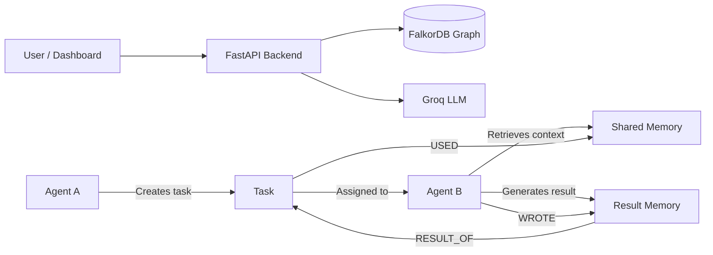

# 🧠 RecallAI

**Shared, persistent memory and coordination for AI agents, powered by FalkorDB.**

Built for the Graph Hackathon, **Track 2: Agent Memory and Coordination**.

---

## 💡 Problem

Most AI agents forget everything when a session ends, and they can't share what they learn with other agents. Teams end up with isolated agents that repeat work, lose context, and can't hand tasks to each other.

## ✅ Solution

RecallAI gives agents a **shared memory layer stored as a graph in FalkorDB**. Agents write what they learn, other agents retrieve it later, tasks are handed off through the graph, and every result becomes new memory for the next agent.

---

## ✨ Features

| Track 2 requirement | How RecallAI covers it |
|---|---|
| Persistent memory | Memories are stored in FalkorDB and survive container restarts when the Docker data volume is retained. |
| Memory versioning | Newer memories can supersede older memories. |
| Shared agent context | Agents can retrieve relevant shared memories. |
| Private memory | Private memories are filtered by the owning agent within a tenant. |
| Tenant isolation | Each tenant uses a separate graph with the `tenant_<tenant_id>` naming convention. |
| Multiple memory types | Supports semantic, episodic, and procedural memories. |
| Agent coordination | Agent A creates and assigns tasks that Agent B can execute. |
| Task result storage | Execution results are saved as memories linked to their tasks. |
| Memory provenance | `USED`, `WROTE`, and `RESULT_OF` relationships help trace task context and results. |
| Concurrent memory writes | 20 out of 20 parallel memory-write requests succeeded in the local test. |
| Concurrent task requests | In one test, 1 of 10 concurrent requests completed the single available task; the other 9 returned HTTP 404. |

---

## 🏗️ Architecture



### Graph model

**Node types**
- `Agent`
- `Task`
- `Memory`
- `Coordination`

**Important relationships**
- `CREATED` — connects an agent to a task it created.
- `ASSIGNED_TO` — connects a task to its assigned agent.
- `COMPLETED` — records an agent's task completion.
- `WROTE` — links an agent to a memory it produced.
- `RESULT_OF` — links a result memory to its task.
- `USED` — records a memory used during task execution.
- `SUPERSEDES` — represents memory versioning when a newer memory replaces an older one.

**Memory properties may include**
- `agent_id`
- `content`
- `visibility`
- `memory_type`
- `created_at`
- Supersession status

Visibility can be `shared` or `private`. Memory types include `semantic`, `episodic`, and `procedural`.

---

## 🛠️ Tech Stack

- **Graph database:** FalkorDB
- **Backend:** Python, FastAPI
- **LLM:** Groq (`openai/gpt-oss-120b`)
- **Frontend:** HTML + JavaScript dashboard
- **Infra:** Docker
- **Concurrency tests:** Python `requests` and `ThreadPoolExecutor`

---

## 🚀 Setup

### Prerequisites

- Python 3.10 or newer
- Docker Desktop
- A Groq API key

### 1. Clone the repository

```powershell
git clone <your-repo-url>
cd <your-repo-folder>
```

Replace the placeholders with your actual repository URL and folder name.

### 2. Start FalkorDB with persistent storage

```powershell
docker run -d --name recallai-falkordb `
  -v falkordb_data:/var/lib/falkordb/data `
  -p 6379:6379 -p 3000:3000 `
  falkordb/falkordb:latest
```

If the container already exists, start it instead:

```powershell
docker start recallai-falkordb
```

The named Docker volume `falkordb_data` retains database files when the container is stopped or recreated without deleting the volume.

- FalkorDB connection: `localhost:6379`
- FalkorDB Browser: http://localhost:3000

### 3. Create a Python virtual environment

```powershell
python -m venv .venv
.\.venv\Scripts\Activate.ps1
```

### 4. Install dependencies

```powershell
python -m pip install -r requirements.txt
```

### 5. Configure environment variables

Create a `.env` file in the project root:

```env
GROQ_API_KEY=your_groq_api_key_here
```

Keep your actual API key private. Do not commit `.env` to GitHub.

If your project includes an `.env.example` file, copy it and fill in your own key.

### 6. Run the application

```powershell
python -m uvicorn app:app --reload
```

Open the following URLs:

- **Dashboard:** http://127.0.0.1:8000/dashboard
- **API documentation:** http://127.0.0.1:8000/docs
- **FalkorDB Browser:** http://localhost:3000

Keep Docker and the FastAPI server running while using RecallAI.

---

## 📡 API Endpoints

The following endpoints are available in the application. Check `/docs` for the exact request schemas and parameters.

| Method | Endpoint | Description |
|---|---|---|
| GET | `/` | Health check |
| POST | `/memories` | Save a memory with visibility and memory type |
| GET | `/memories/{tenant_id}/{agent_id}` | Retrieve accessible memories for an agent |
| GET | `/search/{tenant_id}/{agent_id}?q=...` | Search accessible memories |
| POST | `/memories/update` | Update a memory through versioning |
| POST | `/coordination` | Record a coordination decision |
| GET | `/coordination/{tenant_id}/{agent_id}` | Retrieve coordination history |
| POST | `/run-demo` | Create a task and assign it to an agent |
| POST | `/execute-task` | Execute an assigned task using available context |
| GET | `/tasks/{tenant_id}` | List tasks for a tenant |
| GET | `/dashboard` | Open the web dashboard |
| GET | `/ai-test` | Test the LLM integration |

Endpoint paths and required parameters should be verified against the current implementation in `app.py` and the interactive API documentation.

---

## 🎬 Demo Flow

1. **Store memory:** Agent A saves a shared fact or useful piece of knowledge.
2. **Create a task:** Agent A creates a task and assigns it to Agent B.
3. **Retrieve context:** The application retrieves relevant memories available to Agent B.
4. **Execute the task:** Agent B uses the task and retrieved context to generate a result.
5. **Save the result:** The execution result becomes a memory linked to the task.
6. **Reuse knowledge:** Future tasks can retrieve relevant stored memories.
7. **Verify persistence:** Restart the application and database container, then verify that stored memories remain available.
8. **Verify isolation:** Check that private memories and data from other tenants are not returned by the corresponding API queries.
9. **Explore the graph:** Open FalkorDB Browser to inspect the graph nodes and relationships.

---

## 🧪 Test Results

Local development tests completed:

| Test | Observed result |
|---|---|
| Python syntax check | Passed |
| Memory persistence after Docker restart | Passed |
| Private memory isolation | Passed |
| Tenant isolation | Passed |
| Concurrent memory writes | 20 successful, 0 failed |
| Concurrent task execution requests | 1 successful response, 9 HTTP 404 responses for one available task |

---

### Run the memory-write concurrency test

Install the test dependency if needed:

```powershell
python -m pip install requests
```

Run:

```powershell
python .\test_concurrency.py
```

Observed result:

```text
Requests: 20
Successful: 20
Failed: 0
Total wall time: 7.60s
Median request latency: 4.855s
RESULT: PASS - all memory writes succeeded
```

### Run the task coordination concurrency test

```powershell
python .\test_coordination.py
```

Observed behavior in the tested run:

- One task was created.
- Ten concurrent execution requests were sent.
- One request completed the task.
- Nine requests returned HTTP 404 because no assigned task remained available.
- No other errors were reported.

These are local functional test results, not a comprehensive production load test or a formal proof that every possible race condition has been eliminated.

---

## 🔐 Security and Limitations

- Private and shared memory visibility is enforced by application query filters.
- Tenant-specific graph names separate stored data by tenant.
- Production deployment should add authentication and authorization to bind requests to trusted agent and tenant identities.
- Tenant and agent IDs supplied by unauthenticated callers should not be treated as proof of identity.
- Broader concurrency testing, observability, and failure recovery can further improve reliability.
- LLM responses may need prompt refinement to ensure generated results directly address the assigned task.

---

## 🔭 Future Work

- Embedding-based semantic retrieval alongside keyword matching.
- Improved relevance ranking for retrieved memories.
- Stronger atomic task claiming and explicit race-condition testing.
- Authentication and authorization for agents and tenants.
- More agent roles, such as planner, reviewer, and verifier.
- Better task-specific LLM prompts and result validation.
- Monitoring, metrics, and structured logging.
- Automated integration and load testing.

---

## 👥 Team

- **Shreya** — Project development.

---

## 📄 License

MIT

If you choose the MIT License, add a `LICENSE` file containing the standard MIT License text and your copyright details.

---