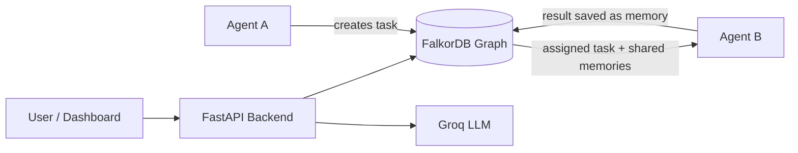

# 🧠 RecallAI

**Shared, persistent memory and coordination for AI agents, powered by FalkorDB.**

Built for the Graph Hackathon, **Track 2: Agent Memory and Coordination**.

---

## 💡 Problem

Most AI agents forget everything when a session ends, and they can't share what they learn with other agents. Teams end up with isolated agents that repeat work, lose context, and can't hand tasks to each other.

## ✅ Solution

RecallAI gives agents a **shared memory layer stored as a graph in FalkorDB**. Agents write what they learn, other agents retrieve it later, tasks are handed off through the graph, and every result becomes new memory for the next agent.

---

## ✨ Features

| Track 2 requirement | How RecallAI covers it |
|---|---|
| Memory persists across sessions | Memories stored in FalkorDB with a Docker volume, so they survive restarts |
| Memory updates over time | Memory versioning, where newer facts supersede older ones |
| Shared state and handoffs | Agent A creates a task, Agent B picks it up from the graph and executes it |
| Available to every agent | Shared memories are retrieved by any agent that needs them |
| Separate memory per user/tenant | Tenant isolation, with private memories visible only to their owner |
| High-concurrency reads and writes | TODO: add concurrency test results here |
| Explainable results | Task results are saved back to the graph and linked to the task |

---

## 🏗️ Architecture



### Graph model

```
(Agent)-[:CREATED]->(Task)
(Task)-[:ASSIGNED_TO]->(Agent)
(Agent)-[:COMPLETED]->(Task)
(Memory)-[:RESULT_OF]->(Task)
```

**Node types:** `Agent`, `Task`, `Memory`, `Coordination`

**Memory properties:** `agent_id`, `content`, `visibility` (`shared` / `private`), `created_at`

<!-- TODO: add any new edges/properties, e.g. SUPERSEDES, WROTE, USED, tenant info -->

---

## 🛠️ Tech Stack

- **Graph database:** FalkorDB
- **Backend:** Python, FastAPI
- **LLM:** Groq (`openai/gpt-oss-120b`)
- **Frontend:** HTML + JavaScript dashboard
- **Infra:** Docker

---

## 🚀 Setup

### 1. Clone the repo

```bash
git clone <your-repo-url>
cd <your-repo-folder>
```

### 2. Start FalkorDB (with persistent storage)

```bash
docker run -d --name falkordb \
  -p 6379:6379 -p 3000:3000 \
  -v falkordb_data:/var/lib/falkordb/data \
  falkordb/falkordb:latest
```

FalkorDB Browser will be available at `http://localhost:3000`.

### 3. Install dependencies

```bash
pip install -r requirements.txt
```

### 4. Set environment variables

Copy `.env.example` to `.env` and add your key:

```
GROQ_API_KEY=your_groq_api_key_here
```

### 5. Run the app

```bash
uvicorn app:app --reload
```

- API docs: `http://localhost:8000/docs`
- Dashboard: `http://localhost:8000/dashboard`

---

## 📡 API Endpoints

| Method | Endpoint | Description |
|---|---|---|
| GET | `/` | Health check |
| POST | `/memories` | Save a memory (shared or private) |
| GET | `/memories/{agent_id}` | Get shared memories and the agent's private ones |
| GET | `/search/{agent_id}?q=...` | Search memories by keyword |
| POST | `/coordination` | Record a coordination decision between agents |
| GET | `/coordination/{agent_id}` | Get coordination history of an agent |
| POST | `/run-demo` | Create a task from Agent A and assign it to Agent B |
| POST | `/execute-task` | Agent B executes its assigned task using shared memory |
| GET | `/tasks` | List recent tasks and their results |
| GET | `/dashboard` | Web dashboard |
| GET | `/ai-test` | Check that the LLM connection works |

<!-- TODO: add tenant-related parameters/endpoints if you added them -->

---

## 🎬 Demo Flow

1. **Save memory:** Agent A stores a shared fact (for example, a project codename).
2. **Assign a task:** Run Demo creates a task from Agent A to Agent B.
3. **Execute:** Agent B pulls relevant shared memories from the graph and completes the task with the LLM.
4. **Result becomes memory:** The answer is saved back into the graph, so any agent can use it later.
5. **Persistence:** Restart the app and Docker container, and memories are still there.
6. **Isolation:** Private memories and other tenants' data are not visible to other agents.
7. **Graph view:** Open FalkorDB Browser (`localhost:3000`) to see agents, tasks and memories connected.

---

## 🔭 Future Work

- Embedding-based semantic retrieval alongside keyword matching
- Explicit episodic, semantic and procedural memory types
- Provenance edges showing exactly which memory each task used
- More agent roles (reviewer, planner) in the coordination chain
- Authentication and per-tenant access control

---

## 👥 Team

- **Shreee**: <!-- TODO: add teammates if any -->

## 📄 License

MIT <!-- or your choice -->